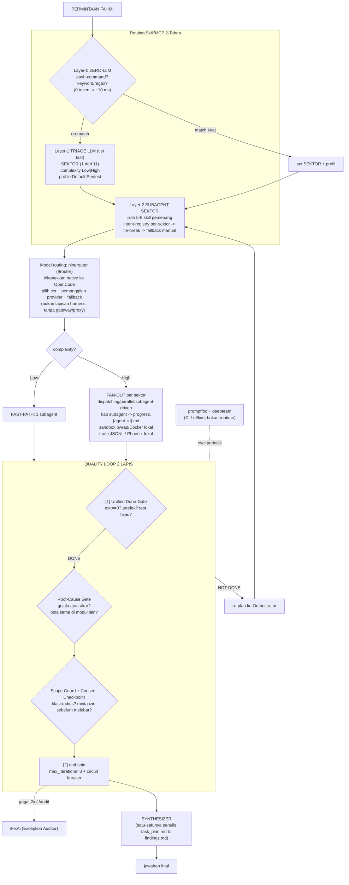

# SuperQuantumAGI — Product Requirements Document (PRD)

> **Produk:** **SuperQuantumAGI** — harness Agentic Orchestrator untuk **OpenCode** (TARGET = OpenCode, BUKAN Claude Code). Dominan orchestrator, ramping/cepat/efisien/efektif/ringan tapi powerful, multi-sektor.
> **Pemilik/Operator tunggal:** Fahmi Harun (GitHub [`kuker24`](https://github.com/kuker24)) — jalan lokal/self-host, satu operator.
> **Tanggal:** 21 Oktober 2026 (Asia/Jakarta, UTC+7) · **Bahasa:** Indonesia teknis
> **Status:** Spesifikasi (SPEC-ONLY). Konsolidasi dari `SuperQ-PRD-v1.1.md`, `superq-routing-matrix-v1.1.md`, `superq-master-catalog-v1.1.md`, `prompt-install-superq-opencode.md`, dengan penerapan keputusan desain terbaru (rename + override). **Bukan dokumen implementasi — tidak ada kode, tidak ada commit/push.**
>
> **Legenda klaim:** `[FAKTA]` = dari file sumber. `[PENILAIAN]` = judgment penyusunan. `[PENILAIAN/target, belum dikalibrasi]` = semua angka SLA/latency/iterasi. `[ASUMSI]` = perlu diverifikasi (mis. nama/lokasi file config OpenCode dari dokumentasi resmi). `[OVERRIDE]` = keputusan desain terbaru yang menang atas file v1.1.
> **Aturan bukti:** tidak ada URL/SHA/benchmark/bintang dikarang. Yang belum pasti -> `URL: TBD` / `pin: TBD`. Secret via `${ENV}`, tidak pernah literal.

---

## Daftar Isi

1. [Ringkasan Eksekutif & Tujuan](#1-ringkasan-eksekutif--tujuan)
2. [Prinsip Desain](#2-prinsip-desain)
3. [Arsitektur Agentic Orchestrator](#3-arsitektur-agentic-orchestrator)
4. [Sistem Routing (2-Tahap Skill/MCP + ninerouter Model)](#4-sistem-routing)
5. [Quality Loop & Prinsip Root-Cause / Stop-and-Ask](#5-quality-loop)
6. [Katalog Komponen Bertier (Lengkap)](#6-katalog-komponen-bertier-lengkap)
7. [MCP: Core-Active, On-Demand, Lazy-Load, re-analysis vs offensive-c2](#7-mcp)
8. [Model Routing: ninerouter (9router)](#8-model-routing-ninerouter)
9. [Local-First Foundation & Observability](#9-local-first)
10. [Lisensi & Kepatuhan](#10-lisensi--kepatuhan)
11. [Requirement Non-Fungsional (NFR)](#11-nfr)
12. [Rencana Instalasi Berfase & Struktur Folder Target](#12-instalasi)
13. [Acceptance Criteria / Done-Gate](#13-acceptance)
14. [Lampiran](#14-lampiran)

---

## 1. Ringkasan Eksekutif & Tujuan

**SuperQuantumAGI** adalah harness agentik untuk **OpenCode** yang **dominan orchestrator**: satu *Orchestrator Core* tipis mendelegasikan subagent **secukupnya** — tugas mudah = **fast-path** (1 subagent), tugas kompleks = **fan-out** per sektor. Harness ini multi-sektor (tidak hanya coding), dijalankan lokal/self-host oleh satu operator (Fahmi). `[FAKTA: konteks produk]`

**Visi — "The Best, tapi RAMPING":** control plane multi-sektor yang mengoptimalkan **kecepatan · efisiensi · efektivitas · ringan · powerful** sekaligus, dengan:
- **Routing skill/MCP 2-tahap** (Layer-0 Zero-LLM -> Layer-1 triage LLM ke ~11 sektor -> Layer-2 subagent sektor memilih 5–8 skill pemenang) menggantikan skor mahal 1-dari-120. `[PENILAIAN]`
- **Model routing lewat ninerouter (9router) SAJA** — LiteLLM dan jev-model-router **dibuang total**. Ninerouter memilih tier model (fast/coding/reasoning) **dan** menangani pemanggilan provider (fallback internal). `[OVERRIDE]`
- **Quality loop 2 lapis** (Unified Done-Gate deterministik + anti-spin hardcoded) + prinsip **root-cause & stop-and-ask**. `[PENILAIAN]`
- **Fondasi local-first ringan** (sandbox bwrap/Docker default, trace JSONL/Phoenix-lokal, validasi schema/Pydantic), dengan opsi cloud on-demand (E2B/Opik). `[PENILAIAN]`
- **Katalog bertier** (T1 Active / T2 External On-Demand / T3 Archive) — tidak ada komponen dibuang, hanya beda status. `[PENILAIAN]`

**Constraint tertinggi (NFR puncak):** instalasi SuperQuantumAGI **TIDAK BOLEH mengubah/patch source atau runtime OpenCode**. SuperQuantumAGI murni **lapisan di atas** OpenCode — lewat file config OpenCode, folder agent/skill, plugin, dan registrasi MCP. **OpenCode tetap vanilla.** `[OVERRIDE/NFR]`

### 1.1 Tujuan (Goals) `[PENILAIAN]`

| ID | Tujuan |
|---|---|
| G1 | Orchestrator Core OpenCode: Layer-0/1 triage -> Layer-2 subagent sektor -> fan-out/fast-path -> quality loop 2 lapis -> synthesizer |
| G2 | Routing skill/MCP 2-tahap akurat (intent registry per-sektor 1-to-1, tie-break, fallback manual deterministik) |
| G3 | Model routing **hanya via ninerouter (9router)**: pilih tier + pemanggilan provider & fallback internal |
| G4 | Bundle permisif bersih (MIT/Apache/BSD/MPL file-level); copyleft/NOASSERTION/tanpa-lisensi hanya pointer/MCP eksternal (tidak di-vendored) |
| G5 | Fondasi ringan local-first: sandbox bwrap/Docker + trace JSONL/Phoenix-lokal + schema/Pydantic |
| G6 | Multi-sektor (11): Orchestration & Quality, Coding/QA/Mobile, RE, Keamanan/Pentest/C2, OSINT, Motion/Media, Data/Dok/CAD, Riset, Penulisan, Karier, DevOps/Infra/Finance |
| G7 | Quality loop 2 lapis (Unified Done-Gate + anti-spin) + root-cause/stop-and-ask; iFixAi Exception Auditor; promptfoo/deepteam di CI/offline |
| G8 | Fast-path untuk tugas mudah; fan-out hanya bila complexity=High |
| G9 | Katalog tiered (T1 aktif / T2 on-demand / T3 archive) — tidak ada komponen di-skip |
| G10 | **OpenCode tetap vanilla:** dipasang murni sebagai lapisan (config/folder/plugin/MCP), tanpa patch source/runtime |

### 1.2 Non-Tujuan (Non-Goals) `[PENILAIAN]`

| ID | Non-tujuan |
|---|---|
| NG1 | Bukan IDE/GUI pesaing |
| NG2 | Bukan vendor-in source GPL/AGPL/NOASSERTION/tanpa-lisensi |
| NG3 | Bukan SaaS multi-tenant; SuperQuantumAGI = harness lokal/self-host satu operator |
| NG4 | Bukan skor 120-skill lagi; bukan model routing 2-3 tingkat (hanya ninerouter); bukan 5 loop mutu |
| NG5 | Bukan filter jailbreak/topik di runtime (workload RE/pentest sah milik operator) |
| NG6 | Bukan menargetkan Claude Code sebagai harness (TARGET = OpenCode) |
| NG7 | **Bukan fork/patch OpenCode** dengan cara apa pun |
| NG8 | **Bukan memakai LiteLLM atau jev-model-router** (dibuang total; tak ada proxy/gateway LiteLLM) |

---

## 2. Prinsip Desain

Target bersama: **ringan tapi powerful**, dan **delegasi secukupnya**.

| # | Prinsip | Penjelasan | Sumber |
|---|---|---|---|
| P1 | **Ramping = cepat + efisien + ringan** | Early-exit Zero-LLM, triage sektor, tier model via ninerouter, local-first | `[PENILAIAN]` |
| P2 | **Delegasi secukupnya** | Fast-path 1 subagent untuk tugas mudah; fan-out hanya bila complexity=High | `[FAKTA]` |
| P3 | **OpenCode vanilla (lapisan di atas)** | Hanya lewat config OpenCode, folder agent/skill, plugin, registrasi MCP; **tidak patch source/runtime** | `[OVERRIDE]` |
| P4 | **Model routing tunggal: ninerouter** | Satu pemilih tier + pemanggil provider; **tanpa LiteLLM/jev-model-router** | `[OVERRIDE]` |
| P5 | **Lisensi permisif bersih** | Vendor hanya MIT/Apache/BSD/(MPL file-level); copyleft/NOASSERTION = pointer eksternal | `[FAKTA]` |
| P6 | **Done-Gate deterministik** | `exit==0? artefak ada? test hijau?` — bukan LLM loop | `[PENILAIAN]` |
| P7 | **Routing deterministik + fallback manual** | Intent registry per-sektor (1-to-1), tie-break, seri->manual (tak menebak) | `[PENILAIAN]` |
| P8 | **Root-cause + stop-and-ask** | Setelah fix lolos tes: gejala vs akar + pola di modul lain; hitung blast radius; minta izin sebelum melebar | `[OVERRIDE]` |
| P9 | **Operator-trust** | Filter jailbreak/topik OFF; otorisasi via consent/scope untuk C2 | `[PENILAIAN]` |
| P10 | **Local-first** | Sandbox bwrap/Docker, observability lokal, schema/Pydantic default; cloud hanya on-demand | `[PENILAIAN]` |
| P11 | **Pin apa adanya** | SHA/URL hanya dari sumber; sisanya `TBD` | `[FAKTA]` |
| P12 | **Target OpenCode** | Konvensi harness ikut OpenCode; komponen asal Claude ditandai `port-OC` | `[FAKTA]` |

---

## 3. Arsitektur Agentic Orchestrator

### 3.1 Komponen inti

| Komponen | Peran |
|---|---|
| **Orchestrator Core** (OpenCode) | plan -> fan-out/fast-path -> gather |
| **Layer-0 Zero-LLM** | slash-command + keyword/regex (0 token) |
| **Layer-1 Triage LLM** | klasifikasi -> 11 sektor + complexity Low\|High + profile Default\|Pentest |
| **Layer-2 Subagent sektor** | pilih 5–8 skill pemenang via intent registry per-sektor |
| **Model routing** | **ninerouter (9router)** dikonekkan **native ke OpenCode** — pilih tier (fast/coding/reasoning) + pemanggilan provider & fallback, ditangani ninerouter sendiri. **Bukan lapisan harness**; SuperQuantumAGI hanya memakai skill bawaan 9router bila perlu |
| **Pool Subagent** | per sektor, paralel secukupnya; sandbox lokal (E2B opsional on-demand) |
| **Quality Loop 2 lapis** | Unified Done-Gate deterministik + anti-spin hardcoded (+ root-cause/stop-and-ask) |
| **Exception Auditor** | iFixAi (hanya saat gagal 2x berturut / `/audit`) |
| **Synthesizer** | gabung hasil; satu-satunya penulis `task_plan.md`/`findings.md` |

### 3.2 Diagram alur end-to-end (mermaid) `[PENILAIAN]`



### 3.3 Catatan arsitektur `[PENILAIAN]`
- Done-Gate gagal -> **re-plan** (bukan klaim sukses).
- **Anti-race:** tiap subagent hanya menulis `progress.{agent_id}.md` (file miliknya); hanya Synthesizer menulis `task_plan.md`/`findings.md` (single-writer).
- Semua komponen dipasang sebagai **lapisan di atas OpenCode** — lihat §12 (struktur folder) & §11 NFR1 (OpenCode vanilla).

---

## 4. Sistem Routing

Sumber: `superq-routing-matrix-v1.1.md`. `[FAKTA struktur]`

### 4.1 Routing skill/MCP 2-tahap `[PENILAIAN]`

- **Layer-0 — Zero-LLM (0 token, instan):**
  - Slash-command eksplisit (`/audit`, `/pentest`, `commands/orchestration/*`) -> handler, tanpa LLM.
  - Keyword/regex match kuat & unik (contoh RE: `/\b(decompile|ghidra|apk|jadx|frida)\b/i`) -> set sektor + profil.
  - Tanpa match kuat -> turun ke Layer-1.
  - Target: 0 token, **< ~10 ms** `[PENILAIAN/target, belum dikalibrasi]`.
- **Layer-1 — Triage LLM (tier fast):** satu panggilan LLM kecil, **3 keluaran saja**:
  1. **SEKTOR** -> 1 dari 11.
  2. **complexity** -> `Low` (fast-path) | `High` (fan-out).
  3. **profile** -> `Default` | `Pentest` (profil `offensive-c2`; butuh `--pentest` + consent/scope).
  - Target: p50 **< ~600 ms** `[PENILAIAN/target, belum dikalibrasi]`.
- **Layer-2 — Subagent sektor:** memilih dari **maks 5–8 skill pemenang (Tier 1)** di sektornya via **intent registry per-sektor** -> tie-break -> fallback manual.

### 4.2 11 Sektor + skill aktif (Tier 1) + keyword Layer-0 `[PENILAIAN]`

| # | SEKTOR | Skill aktif (5–8 pemenang T1) | Keyword Layer-0 (contoh) |
|---|---|---|---|
| 1 | **Orchestration & Quality** | dispatching-parallel-agents, parallel-agents, subagent-driven-development, planning-with-files, Unified Done-Gate, iFixAi, commands/orchestration/* | orchestrate, plan, fan-out, `/start` `/status` `/resume` |
| 2 | **Coding/Engineering/QA/Mobile** | codebase-design, diagnosing-bugs, matt-code-review, tdd, to-spec/to-tickets, playwright-qa, (ECC api-design), (pstack architect/interrogate) | bug, refactor, PR, test, API, build |
| 3 | **Reverse Engineering** | reverse-skill (router), hypeking (sub-modul), rea, universal-modder | decompile, ghidra, apk, binary, hook, mod |
| 4 | **Keamanan/Pentest/C2** | full-audit-keamanan, cli-pentestv1, strix, PentAGI, caldera, deepteam | pentest, exploit, c2, recon, scope |
| 5 | **OSINT/Geospatial** | geo-sleuth, leafmap | geolocate, osint, satellite, coordinates |
| 6 | **Desain/Motion/Media** | claude-motion-design, claude-remotion-skill, gsap-skills, manim, hyperframes, diagram-design, deck-design | animation, motion, video, diagram, slide |
| 7 | **Data/Dokumen/CAD/Otomasi** | markitdown, docx/pptx/xlsx/pdf-official, text-to-cad, n8n, pageindex | pdf, docx, excel, cad, workflow |
| 8 | **Riset** | deep-research, deep-research-team, nia-oracle | research, paper, arxiv, investigate |
| 9 | **Penulisan/Produktivitas** | humanizer, install-anti-slop, technical-writing, unslop, penulis-ilmiah, academic, antislop-sampler | write, humanize, de-slop, docs |
| 10 | **Karier** | ai-job-search | job, CV, resume, cover letter, interview |
| 11 | **DevOps/Infra/Finance** | full-performance-audit (+ MCP: github/kubernetes-mcp-server, OpenBB) | repo, CI, k8s, deploy, stock, finance |

### 4.3 Menjaga akurasi `[PENILAIAN]`
1. **Intent registry per-sektor (1-to-1):** tiap skill Tier 1 punya `intent-key` **unik dalam sektornya** — tak ada 2 skill aktif berbagi intent-key.
2. **Tie-break** merujuk daftar keputusan "mirip -> pemenang" (§6.13 + master catalog §12).
3. **Fallback deterministik ke `manual`:** seri + tanpa aturan -> minta disambiguasi / subagent generik. **Tidak menebak.**
4. **Verifikasi:** Unified Done-Gate memastikan rute menyelesaikan tugas; anti-spin memotong rute mandek.

### 4.4 Model routing — hanya ninerouter `[OVERRIDE]`
Lihat §8. Ringkas: **ninerouter (9router) sudah dikonekkan native ke OpenCode** dan menangani pemilihan tier + pemanggilan provider + fallback sendiri. **Tidak ada lapisan/konfig model-routing custom yang perlu dibangun di harness**, tidak ada proxy/gateway, **tanpa LiteLLM, tanpa jev-model-router**.

---

## 5. Quality Loop & Prinsip Root-Cause / Stop-and-Ask

### 5.1 Quality loop 2 lapis `[PENILAIAN]`

**Lapis 1 — Unified Done-Gate (deterministik).** Melebur `builder-reviewer-loop` + `completion-contract-loop` menjadi satu gate berbasis cek konkret (bukan LLM):
```
DONE jika dan hanya jika:
  exit_code == 0            (perintah sukses)
  AND artefak target ada    (file/output yang dijanjikan)
  AND test hijau            (suite/relevant test pass)
Else -> NOT DONE -> kembali ke Orchestrator (re-plan), bukan klaim sukses.
```

**Lapis 2 — anti-spin (hardcoded counter).** Loop counter di harness: `max_iterations = 3`, lalu **circuit breaker** (stop deterministik). **BUKAN LLM loop.** Memotong run mandek/flip-flop/budget habis.

**Di luar 2 lapis (bukan runtime per-request):**
- **iFixAi = Exception Auditor:** dipanggil **hanya** saat subagent gagal **2x berturut** ATAU via `/audit`. Target < 120 s per audit `[PENILAIAN/target, belum dikalibrasi]`.
- **promptfoo + deepteam = CI/offline eval periodik** (bukan runtime per-request).
- **Guardrails jailbreak/topik = OFF**; validasi I/O runtime hanya **schema/Pydantic** (struktur), karena workload RE/pentest sah milik operator.

### 5.2 Prinsip Root-Cause + Stop-and-Ask `[OVERRIDE]`

Perilaku sistem tambahan (dari analisis model Anthropic), dipasang sebagai langkah deterministik di dalam Quality Loop & triage:

| Kode | Perilaku | Definisi |
|---|---|---|
| RCG | **Root-Cause Gate** | Setelah fix lolos tes, subagent **wajib** menjawab: (a) "ini gejala atau akar?"; (b) "apakah pola sama ada di modul lain?" (grep/semantic search). Hanya gejala -> catat + usul perbaikan akar (tidak otomatis melebar — lihat CCP). |
| SCG | **Scope Guard** | Hitung **blast radius** sebelum fan-out lintas-modul. Perubahan di luar modul target menaikkan level persetujuan. |
| CCP | **Consent Checkpoint** | Default = **patch minimal**. Orchestrator **BERHENTI & minta izin** sebelum melebarkan perubahan di luar permintaan awal. |
| ITT | **Intent vs Task (di triage)** | Pisahkan "permintaan permukaan" vs "tujuan sebenarnya". Mode cepat (mis. production outage) = **patch minimal**, tunda refaktor akar sampai disetujui. |

> **Catatan alur:** RCG/SCG/CCP ditempatkan setelah Done-Gate DONE dan sebelum Synthesizer (lihat §3.2). ITT ditempatkan di Layer-1 triage. Semua bersifat **stop-and-ask**: SuperQuantumAGI tidak melebarkan perubahan tanpa izin operator.

---

## 6. Katalog Komponen Bertier (Lengkap)

> Kolom: **Nama | TIER | Kategori | SUMBER REPO (URL) | Lisensi | Status Port OpenCode**.
> Kategori: `skill` / `MCP` / `plugin/command` / `loop` / `agent` / `router` / `pointer/endpoint` / `harness-native` / `library` / `starter`.
> Port OpenCode: `native-OC` (ditulis langsung di harness) · `port-OC` (perlu port/adaptasi dari format Claude) · `mcp-OC` (daftar di mcp block config OpenCode) · `endpoint`/`CLI` (dipanggil eksternal tanpa vendor-in).
> URL apa adanya dari sumber; belum ada = `URL: TBD`; pin belum ada = `pin: TBD`. **(!)** = lisensi tidak permisif/tidak ada -> tidak di-vendored.
> **Aturan Fahmi:** tidak ada komponen dibuang — hanya beda TIER. `[FAKTA]`

### §6.1 — Orchestration & Quality

| Nama | TIER | Kategori | Sumber Repo (URL) | Lisensi | Port OC |
|---|---|---|---|---|---|
| dispatching-parallel-agents | T1 | skill | https://github.com/davila7/claude-code-templates (pin: TBD) | MIT | port-OC |
| parallel-agents | T1 | skill | https://github.com/davila7/claude-code-templates (pin: TBD) | MIT | port-OC |
| subagent-driven-development | T1 | skill | https://github.com/davila7/claude-code-templates (pin: TBD) | MIT | port-OC |
| multi-agent-coordinator | T1 | agent | https://github.com/davila7/claude-code-templates `expert-advisors/` (pin: TBD) | MIT | port-OC |
| builder-reviewer-loop -> Unified Done-Gate | T1 | loop | https://github.com/davila7/claude-code-templates `engineering/` (pin: TBD) | MIT | port-OC |
| completion-contract-loop -> Unified Done-Gate | T1 | loop | https://github.com/davila7/claude-code-templates `loops/` (pin: TBD) | MIT | port-OC |
| Unified Done-Gate | T1 | harness-native | (first-party, ditulis di harness) | MIT | native-OC |
| anti-spin (circuit breaker) | T1 | harness-native | (first-party, hardcoded `max_iterations=3`) | MIT | native-OC |
| Root-Cause/Scope/Consent gate | T1 | harness-native | (first-party, lihat §5.2) | MIT | native-OC |
| ninerouter (9router) | T1 | router (native OpenCode) | https://github.com/decolua/9router (pin: `a99cf57239ff778b61e434c2786009d5ed1c412c` / v0.5.95) | MIT | native-OC (sudah dikonekkan ke OpenCode; pakai skill bawaan bila perlu) |
| planning-with-files | T1 | skill | https://github.com/davila7/claude-code-templates `productivity/workflow-automation` (pin: TBD) | MIT | port-OC |
| context-window-management | T1 | skill | https://github.com/davila7/claude-code-templates `ai-research/` (pin: TBD) | MIT | port-OC |
| prompt-caching | T1 | skill | https://github.com/davila7/claude-code-templates `ai-research/` (pin: TBD) | MIT | port-OC |
| commands/orchestration/* (start,status,resume,sync,feature-pipeline,report) | T1 | plugin/command | https://github.com/davila7/claude-code-templates `commands/orchestration/` (pin: TBD) | MIT | port-OC |
| human-approval-loop | T1 | loop | https://github.com/davila7/claude-code-templates `loops/` (pin: TBD) | MIT | port-OC |
| tdd-orchestrator | T1 | skill | https://github.com/davila7/claude-code-templates `development/` (pin: TBD) | MIT | port-OC |
| schema/Pydantic I/O validator | T1 | harness-native | (first-party) | MIT | native-OC |
| iFixAi | T1 | agent (Exception Auditor) | https://github.com/ifixai-ai/iFixAi (pin: TBD) | Apache-2.0 | port-OC |
| adversarial-review-loop | T3 | loop | https://github.com/davila7/claude-code-templates `loops/` (pin: TBD) | MIT | port-OC |
| devils-advocate-loop | T3 | loop | https://github.com/davila7/claude-code-templates `loops/` (pin: TBD) | MIT | port-OC |
| quality-streak-loop | T3 | loop | https://github.com/davila7/claude-code-templates `loops/` (pin: TBD) | MIT | port-OC |
| anti-spin-build-loop | T3 | loop | https://github.com/davila7/claude-code-templates `loops/` (pin: TBD) | MIT | port-OC |
| LiteLLM (DIBUANG) | T3 | gateway/proxy | https://github.com/BerriAI/litellm (pin: TBD) | MIT | — |
| jev-model-router (DIBUANG) | T3 | mod (hook TS) | https://github.com/davila7/claude-code-templates `mods/productivity/` (pin: TBD) | MIT | port-OC |
| workflow-orchestrator | T3 | agent | https://github.com/davila7/claude-code-templates `expert-advisors/` (pin: TBD) | MIT | port-OC |
| error-coordinator | T3 | agent | https://github.com/davila7/claude-code-templates `expert-advisors/` (pin: TBD) | MIT | port-OC |
| it-ops-orchestrator | T3 | agent | https://github.com/davila7/claude-code-templates `expert-advisors/` (pin: TBD) | MIT | port-OC |
| think-tank | T3 | skill | https://github.com/davila7/claude-code-templates `productivity/` (pin: TBD) | MIT | port-OC |
| ai-maestro/* | T3 | skill | https://github.com/davila7/claude-code-templates (pin: TBD) | MIT (cek per-item) | port-OC |
| loki-mode (!) | T3 | skill | https://github.com/davila7/claude-code-templates `ai-research/` (pin: TBD) | repo induk MIT `[FAKTA]` (© 2025 Daniel (San) Ávila); [AMBIGU: subfolder bisa punya LICENSE sendiri — cek per-file] (!) | port-OC |
| Opik (Comet) | T2 | pointer/endpoint | https://github.com/comet-ml/opik (pin: TBD) | Apache-2.0 | endpoint |
| E2B | T2 | pointer/endpoint (sandbox cloud) | https://github.com/e2b-dev/E2B (pin: TBD) | Apache-2.0 | endpoint |
| promptfoo | T2 | CLI (eval/red-team) | https://github.com/promptfoo/promptfoo (pin: TBD) | MIT | CLI |
| Guardrails AI (filter OFF) | T2 | pointer/endpoint | https://github.com/guardrails-ai/guardrails (pin: TBD) | Apache-2.0 | endpoint |

> **Phoenix-lokal:** observability default harian memakai trace JSONL dan/atau Arize Phoenix dijalankan **lokal**. Phoenix = Elastic License 2.0 (non-OSI (!)) -> **jalankan sebagai layanan lokal, jangan vendor-in**. `[FAKTA: gap-analysis]`
> **LiteLLM:** di v1.1 LiteLLM = core-active, tetapi per keputusan terbaru **LiteLLM DIBUANG total** (bersama jev-model-router) -> T3 (arsip), bukan di jalur runtime. Model routing hanya via ninerouter. `[OVERRIDE]`

### §6.2 — Coding / Engineering / QA / Mobile

| Nama | TIER | Kategori | Sumber Repo (URL) | Lisensi | Port OC |
|---|---|---|---|---|---|
| mattpocock/skills (bundle 13) | T1 | skill (bundle) | https://github.com/mattpocock/skills (pin: `d81f3a183412e71a5b1e84ca21bc1a35eea03a60` / v1.3.0) | MIT | port-OC |
| ECC (bundle 9) | T1 | skill (bundle) | https://github.com/affaan-m/ECC (pin: TBD) | MIT | port-OC |
| pstack/plugins (bundle 10) | T1 | plugin/command (bundle) | https://github.com/cursor/plugins (pin: `e43c7ee26e0038c6c1fa8380dd34ce86ff94cb2a` / v0.15.9) | MIT | port-OC |
| playwright-qa | T1 | skill | https://github.com/microsoft/playwright-cli (pin: `b85c7a736bb473bf55b584e54a09ffa698d6d871`) | Apache-2.0 | port-OC |
| codebase-memory-mcp | T1 | MCP (core-active) | https://github.com/DeusData/codebase-memory-mcp (v0.11.0; sha256 `1f9e8293eb2bc5c05cfa27a7e8fc033da6d729ffad525ccfcdaa3fd606306683`) | MIT `[FAKTA: GitHub 21 Okt 2026]` (© 2025 DeusData; repo kanonik — fork lain: win4r/…-pro, stevenke1981/opencode-… bukan dipakai) | mcp-OC |
| context7 | T1 | MCP (core-active) | https://mcp.context7.com/mcp (repo: https://github.com/upstash/context7) | MIT `[FAKTA]` (© 2021 Upstash, Inc.; endpoint hosted = layanan, bukan vendor) | mcp-OC |
| shadcn | T1 | MCP (core-active) | https://github.com/shadcn-ui/ui (v4.21.1) | MIT `[FAKTA]` (© 2023 shadcn; MCP resmi = `packages/shadcn` di repo yang sama, MIT) | mcp-OC |
| mongodb-ops | T1 | skill | URL: TBD (first-party OCH) | MIT | port-OC |
| supabase-ops | T1 | skill | URL: TBD (first-party OCH) | MIT | port-OC |
| vercel-ops | T1 | skill | URL: TBD (first-party OCH) | MIT | port-OC |
| impeccable | T1 | skill | URL: TBD (GrokBestFriend snapshot; pin `cd12f8660e2d` / skill-v4.3.1) | Apache-2.0 | port-OC |
| browser-act | T1 | skill | URL: TBD (GrokBestFriend snapshot; pin `11c057b03f92101642cadc9f840564574120d184`) | MIT | port-OC |
| chrome-devtools-axi | T1 | skill | URL: TBD (GrokBestFriend snapshot) | MIT | port-OC |
| gh-axi | T1 | skill | URL: TBD (GrokBestFriend snapshot) | MIT | port-OC |
| adhd | T1 | skill | URL: TBD (vendored OCH) | MIT | port-OC |
| demo-video | T1 | plugin/command | URL: TBD (first-party OCH) | MIT | port-OC |
| id-demo-video | T1 | skill | URL: TBD (first-party OCH) | MIT | port-OC |
| serena | T2 | MCP (on-demand) | https://github.com/oraios/serena (serena-agent v1.7.0) | GPL-3.0-or-later (aplikasi Serena) + MIT (SolidLSP) `[FAKTA]` (SPDX GitHub: NOASSERTION karena per-komponen; © 2025-2026 Jain & Panchenko IT-Berater Partnerschaft / Oraios AI) -> **jangan vendor; jalankan sebagai proses MCP eksternal** | mcp-OC |
| mobile-mcp | T2 | MCP (on-demand) | https://github.com/mobile-next/mobile-mcp (pin: TBD) | Apache-2.0 | mcp-OC |
| stitch | T2 | MCP (on-demand) | https://stitch.googleapis.com/mcp | — | mcp-OC |
| ui-skills | T2 | MCP (on-demand) | https://www.ui-skills.com/mcp | — | mcp-OC |
| reticle (!) | T2 | MCP/endpoint (non-OSI) | URL: TBD (`@reticlehq/server` v3.5.0) | FSL-1.1-ALv2 (!) | endpoint |
| swarmvault | T3 | skill | https://github.com/davila7/claude-code-templates `development/` (pin: TBD) | MIT | port-OC |

### §6.3 — Reverse Engineering (WAJIB)

> `reverse-skill` = **router utama RE**; `hypeking` = **sub-modul**. Lazy-load profil **`re-analysis`** (aman, tanpa `--pentest`) — **PISAH** dari `offensive-c2` (§6.4).

| Nama | TIER | Kategori | Sumber Repo (URL) | Lisensi | Port OC |
|---|---|---|---|---|---|
| reverse-skill | T1 | skill (router RE) | https://github.com/zhaoxuya520/reverse-skill (pin: TBD) | MIT | port-OC |
| hypeking | T1 | skill (sub-modul) | https://github.com/kuker24/cli-pentestv1 (pin: `fda8e627f43897884c6c9802619fe839fa149391`) | MIT | port-OC |
| rea | T1 | skill | https://github.com/morluto/rea (pin: TBD) | MIT | port-OC |
| universal-modder | T1 | skill + MCP | https://github.com/rehan-remade/universal-modder (pin: TBD) | MIT | port-OC |
| ghidra | T2 | MCP (profil re-analysis, lazy) | https://github.com/kuker24/cli-pentestv1 (pin: `fda8e627...`; `http://127.0.0.1:8765/mcp`) | MIT (bundle); Ghidra Apache-2.0 | mcp-OC |
| jshook | T2 | MCP (profil re-analysis, lazy) | https://github.com/kuker24/cli-pentestv1 (pin: `fda8e627...`; npm `@jshookmcp/jshook@0.3.4`) | MIT | mcp-OC |
| idapro | T2 | MCP (profil re-analysis, lazy) | https://github.com/kuker24/cli-pentestv1 (pin: `fda8e627...`; `http://127.0.0.1:13337/mcp`) | MIT (bundle); IDA proprietary | mcp-OC |
| autogki-patcher (!) | T3 | pointer (referensi-saja) | https://github.com/femmynuppu/autogki-patcher (pin: TBD) | — (tidak ada) (!) | endpoint |

### §6.4 — Keamanan / Pentest / C2

> Profil **`offensive-c2` WAJIB flag `--pentest` + file consent/scope** sebelum aktif (NFR11). Item GPL/AGPL/NOASSERTION (!) = pointer/MCP/binary eksternal, **bukan vendored**.

| Nama | TIER | Kategori | Sumber Repo (URL) | Lisensi | Port OC |
|---|---|---|---|---|---|
| cli-pentestv1 (bundle skills+MCP) | T1 | bundle | https://github.com/kuker24/cli-pentestv1 (pin: `fda8e627f43897884c6c9802619fe839fa149391`) | MIT | port-OC |
| full-audit-keamanan | T1 | skill | URL: TBD (OCH GrokBestFriend 1.3.1 snapshot) | MIT | port-OC |
| strix | T2 | pointer/harness (offensive-c2) | https://github.com/usestrix/strix (pin: TBD) | Apache-2.0 | endpoint |
| PentAGI | T2 | MCP/pointer (offensive-c2) | https://github.com/vxcontrol/pentagi (pin: TBD) | MIT | endpoint |
| caldera | T2 | pointer (offensive-c2) | https://github.com/apache/caldera (pin: TBD) | Apache-2.0 | endpoint |
| deepteam | T2 | CLI (red-team CI/offline) | https://github.com/confident-ai/deepteam (pin: TBD) | Apache-2.0 | CLI |
| sliver (!) | T2 | MCP/pointer (offensive-c2) | https://github.com/BishopFox/sliver (juga cli-pentestv1 `fda8e627...`) | GPL-3.0 (!) | endpoint |
| AdaptixC2 (!) | T2 | pointer (offensive-c2) | https://github.com/Adaptix-Framework/AdaptixC2 (pin: TBD) | GPL-3.0 (!) | endpoint |
| bunkerweb (!) | T2 | pointer (WAF on-demand) | https://github.com/bunkerity/bunkerweb (pin: TBD) | AGPL-3.0 (!) | endpoint |
| Fieldwatch | T2 | pointer (OSINT receive-only) | https://github.com/OffGridPete/Fieldwatch (pin: TBD) | MIT | endpoint |
| Mythic | T2 | pointer (alt permisif C2) | https://github.com/its-a-feature/Mythic (pin: TBD) | BSD-3-Clause | endpoint |
| Decepticon | T2 | pointer (alt permisif red-team) | https://github.com/BitterSecurity/Decepticon (pin: TBD) | Apache-2.0 | endpoint |
| ARTEX (!) | T3 | pointer (digantikan -> PentAGI) | https://github.com/Hinln/ARTEX (pin: TBD) | AGPL-3.0 (!) | endpoint |
| CyberStrike (!) | T3 | pointer (digantikan -> Decepticon) | https://github.com/CyberStrikeus/CyberStrike (pin: TBD) | AGPL-3.0 (!) | endpoint |

### §6.5 — OSINT / Geospatial

| Nama | TIER | Kategori | Sumber Repo (URL) | Lisensi | Port OC |
|---|---|---|---|---|---|
| geo-sleuth | T1 | skill | https://github.com/Oldcircle/geo-sleuth (pin: TBD) | MIT | port-OC |
| leafmap | T1 | library/skill | https://github.com/opengeos/leafmap (pin: TBD) | MIT | port-OC |
| TorchGeo | T2 | library/endpoint | https://github.com/torchgeo/torchgeo (pin: TBD) | MIT | endpoint |
| gods-eye-view (!) | T3 | pointer (digantikan leafmap) | https://github.com/bilawalsidhu/gods-eye-view (pin: TBD) | NOASSERTION (!) | endpoint |

### §6.6 — Desain / Motion / Media

> **4 inti aktif:** claude-motion-design, claude-remotion-skill, gsap-skills, manim. `remotion-dev/skills` (tanpa LICENSE) -> DIGANTI claude-remotion-skill (MIT). `klik-anim` (tanpa lisensi) -> T3 sampai ditulis ulang.

| Nama | TIER | Kategori | Sumber Repo (URL) | Lisensi | Port OC |
|---|---|---|---|---|---|
| claude-motion-design | T1 | skill | https://github.com/howseen-ai/claude-motion-design (pin: TBD) | MIT | port-OC |
| claude-remotion-skill | T1 | skill | https://github.com/haidrrrry/claude-remotion-skill (pin: TBD) | MIT | port-OC |
| gsap-skills | T1 | skill | https://github.com/greensock/gsap-skills (pin: TBD) | MIT | port-OC |
| manim | T1 | skill | https://github.com/davila7/claude-code-templates `skills/video/` (pin: TBD) | MIT (cek upstream Manim) | port-OC |
| hyperframes | T1 | skill | https://github.com/heygen-com/hyperframes (pin: `6037d228441e23e50cd6713a464d6158941cfcae` / v0.8.122) | Apache-2.0 | port-OC |
| diagram-design | T1 | skill | https://github.com/cathrynlavery/diagram-design (pin: `f903933a534b`) | MIT | port-OC |
| deck-design | T1 | skill | https://github.com/carnot-tech/consulting-pptx-skill (pin: `f50edac656d34636f026afec9e6dbb3697f4c6d4`) | MIT | port-OC |
| json-render | T1 | skill | https://github.com/vercel-labs/json-render (pin: `c2600d73908ed505e6d726f5b6f969ba8f597ce7`) | Apache-2.0 | port-OC |
| emil-design-eng | T1 | skill | URL: TBD (OCH snapshot; pin `e8a175de22ae1e49370fc144c1f3bb9aeedf988d`) | MIT | port-OC |
| remotion (!) | T2 | engine/pointer | https://github.com/remotion-dev/remotion (pin: TBD) | NOASSERTION (non-OSI) (!) | endpoint |
| motion (library) | T2 | library/pointer | https://github.com/motiondivision/motion (pin: TBD) | MIT | endpoint |
| Revideo | T2 | engine/pointer (alt permisif Remotion) | https://github.com/midrender/revideo (pin: TBD) | MIT | endpoint |
| elevenlabs | T2 | MCP (on-demand TTS) | https://github.com/davila7/claude-code-templates `mcps/audio/` (pin: TBD) | resmi ElevenLabs | mcp-OC |
| remotion-dev/skills (!) | T3 | skill (digantikan) | https://github.com/remotion-dev/skills (pin: TBD) | — (tidak ada) (!) | — |
| klik-anim-skill-creation (!) | T3 | skill (tulis ulang MIT) | https://github.com/t3knobox/klik-anim-skill-creation (pin: TBD) | — (tidak ada) (!) | — |
| motion-graphics-skills | T3 | skill (konsolidasi) | https://github.com/charlie947/motion-graphics-skills (pin: TBD) | MIT | port-OC |
| hyperframes-motion-reel-skill | T3 | skill (konsolidasi) | https://github.com/Sunwood-ai-labs/hyperframes-motion-reel-skill (pin: TBD) | MIT | port-OC |
| product-launch-motion | T3 | skill | https://github.com/AbubakrChan/product-launch-motion (pin: TBD) | MIT | port-OC |
| claude-motion | T3 | skill | https://github.com/whaleyxbt/claude-motion (pin: TBD) | MIT | port-OC |
| motion-canvas | T3 | skill | https://github.com/davila7/claude-code-templates `skills/video/` (pin: TBD) | MIT | port-OC |
| animata | T3 | komponen | https://github.com/codse/animata (pin: TBD) | MIT | port-OC |
| lottie-web | T3 | library/pointer | https://github.com/airbnb/lottie-web (pin: TBD) | MIT | endpoint |
| awesome-motion-design-agent-skills | T3 | kurasi | https://github.com/frankxai/awesome-motion-design-agent-skills (pin: TBD) | CC0-1.0 | — |
| business-motion-film | T3 | skill | https://github.com/echris6/motion-video-kit (pin: `255562b04b1e5ecaa4ba98e5c9aa191d5ba7f6fa`) | MIT | port-OC |
| scroll-craft | T3 | skill | https://github.com/nateherkai/scroll-craft (pin: `75d81f74e83692add18cd7a8a8e078b8a887a579`) | MIT | port-OC |
| scroll-world | T3 | skill | https://github.com/oso95/scroll-world (pin: `71cc36d3bb150248ae36a2c552f9cbf88802a79c`) | MIT | port-OC |
| found-this-design | T3 | skill | URL: TBD (OCH snapshot) | MIT | port-OC |
| visual-studio | T3 | skill | URL: TBD (OCH snapshot) | MIT | port-OC |
| excalidraw / draw-io / mermaid-diagrams / c4-architecture / marp-slide (5) | T3 | skill | https://github.com/davila7/claude-code-templates `creative-design/` (pin: TBD) | MIT | port-OC |

### §6.7 — Data / Dokumen / CAD / Otomasi

| Nama | TIER | Kategori | Sumber Repo (URL) | Lisensi | Port OC |
|---|---|---|---|---|---|
| markitdown (skill) | T1 | skill | https://github.com/microsoft/markitdown (pin: `b8f79c57ebc0044be41323d89b2a45d3fda8460e` / v0.1.8) | MIT | port-OC |
| docx-official (!) | T1 | skill | https://github.com/davila7/claude-code-templates `document-processing/` (pin: TBD) | Anthropic-attribution (!) | port-OC |
| pptx-official (!) | T1 | skill | https://github.com/davila7/claude-code-templates `document-processing/` (pin: TBD) | Anthropic-attribution (!) | port-OC |
| xlsx-official (!) | T1 | skill | https://github.com/davila7/claude-code-templates `document-processing/` (pin: TBD) | Anthropic-attribution (!) | port-OC |
| pdf-official (!) | T1 | skill | https://github.com/davila7/claude-code-templates `document-processing/` (pin: TBD) | Anthropic-attribution (!) | port-OC |
| text-to-cad | T1 | skill | https://github.com/earthtojake/text-to-cad (pin: TBD) | MIT | port-OC |
| n8n / n8n-workflow-patterns | T1 | skill | https://github.com/davila7/claude-code-templates (pin: TBD) | MIT | port-OC |
| pageindex | T1 | skill | https://github.com/VectifyAI/PageIndex (pin: `6d23caf416858f2ca136840305d1f479a86f6ef7` / v0.2.21) | MIT | port-OC |
| smartdoc | T1 | skill | URL: TBD (first-party OCH) | MIT | port-OC |
| smartbook-ingest | T1 | skill | URL: TBD (first-party OCH) | MIT | port-OC |
| markitdown (MCP) | T2 | MCP (on-demand) | https://github.com/microsoft/markitdown (markitdown-mcp v0.1.8 `b8f79c57...`) | MIT | mcp-OC |
| n8n-mcp | T2 | MCP (on-demand) | https://github.com/davila7/claude-code-templates `mcps/integration/` (pin: TBD) | MIT | mcp-OC |
| Postgres MCP Pro | T2 | MCP (on-demand) | https://github.com/crystaldba/postgres-mcp (pin: TBD) | MIT | mcp-OC |
| memory-integration | T3 | MCP | https://github.com/davila7/claude-code-templates `mcps/integration/` (pin: TBD) | MIT | mcp-OC |

### §6.8 — Riset

| Nama | TIER | Kategori | Sumber Repo (URL) | Lisensi | Port OC |
|---|---|---|---|---|---|
| deep-research | T1 | skill | https://github.com/davila7/claude-code-templates `skills/ai-research/` (pin: TBD) | cek (MIT) | port-OC |
| deep-research-team | T1 | agent team | https://github.com/davila7/claude-code-templates (pin: TBD) | MIT `[FAKTA: repo induk]` (© 2025 Daniel (San) Ávila) | port-OC |
| nia-oracle | T1 | agent | https://github.com/davila7/claude-code-templates (pin: TBD) | cek | port-OC |
| arxiv-mcp-server | T2 | MCP (on-demand) | https://github.com/davila7/claude-code-templates `mcps/research/` (pin: TBD) | MIT `[FAKTA: repo induk davila7]`; [AMBIGU: server upstream arxiv-mcp-server bisa berlisensi lain — TBD] | mcp-OC |
| mcp-server-nia | T2 | MCP (on-demand) | https://github.com/davila7/claude-code-templates `mcps/deepresearch/` (pin: TBD) | cek | mcp-OC |
| searxng | T2 | MCP (on-demand) | https://github.com/davila7/claude-code-templates `mcps/web/` (pin: TBD) | cek | mcp-OC |
| jina-ai | T2 | MCP (on-demand) | https://github.com/davila7/claude-code-templates `mcps/devtools/` (pin: TBD) | cek | mcp-OC |
| crawl4ai | T2 | MCP (on-demand) | https://github.com/unclecode/crawl4ai (v0.9.4 `133e1d92e37885dfccc03ea2e3687d06c98b7ceb`) | Apache-2.0 + klausul atribusi wajib UncleCode `[FAKTA]` | mcp-OC |
| scrapling | T2 | MCP (on-demand) | https://github.com/D4Vinci/Scrapling (v0.4.15 `333fa22b7a5821194ce66b59b11f4b16a6484f02`) | BSD-3-Clause | mcp-OC |
| exa | T2 | MCP (on-demand) | https://mcp.exa.ai/mcp | — | mcp-OC |
| deep-research-notebooklm | T3 | skill | https://github.com/davila7/claude-code-templates `skills/ai-research/` (pin: TBD) | cek | port-OC |
| perplexity | T3 | skill | https://github.com/davila7/claude-code-templates `skills/ai-research/` (pin: TBD) | cek | port-OC |

### §6.9 — Penulisan / Produktivitas

| Nama | TIER | Kategori | Sumber Repo (URL) | Lisensi | Port OC |
|---|---|---|---|---|---|
| humanizer | T1 | skill | https://github.com/blader/humanizer (pin: `225a6f39ac85`) | MIT | port-OC |
| install-anti-slop | T1 | skill | https://github.com/dmmulroy/anti-slop (pin: `c44ef22ca116d0ba62a3ff663a0bd13a3f3fa40b` / v0.1.2) | MIT | port-OC |
| technical-writing | T1 | plugin/command | https://github.com/cursor/plugins (pin: `e43c7ee2...`) | MIT | port-OC |
| unslop | T1 | plugin/command | https://github.com/cursor/plugins (pin: `e43c7ee2...`) | MIT | port-OC |
| penulis-ilmiah (skill) | T1 | skill | URL: TBD (first-party OCH) | MIT | port-OC |
| academic | T1 | skill | URL: TBD (first-party OCH) | MIT | port-OC |
| antislop-sampler | T1 | library/pointer | https://github.com/sam-paech/antislop-sampler (pin: TBD) | Apache-2.0 | endpoint |
| penulis-ilmiah (MCP) | T2 | MCP (on-demand) | URL: TBD (npm penulis-ilmiah-mcp v0.1.0) | — | mcp-OC |
| avoid-ai-writing | T3 | skill | https://github.com/davila7/claude-code-templates (pin: TBD) | MIT | port-OC |
| skill-judge / skill-creator / writing-skills (3) | T3 | skill | https://github.com/davila7/claude-code-templates (pin: TBD) | MIT | port-OC |
| Turnitout-Humanizer (!) | T3 | pointer (digantikan antislop-sampler) | https://github.com/AhmadHassan-BTed/Turnitout-Humanizer (pin: TBD) | NOASSERTION (!) | endpoint |

### §6.10 — Karier

| Nama | TIER | Kategori | Sumber Repo (URL) | Lisensi | Port OC |
|---|---|---|---|---|---|
| ai-job-search | T1 | framework/skill | https://github.com/MadsLorentzen/ai-job-search (pin: TBD) | MIT | port-OC |

### §6.11 — DevOps / Infra / Finance

| Nama | TIER | Kategori | Sumber Repo (URL) | Lisensi | Port OC |
|---|---|---|---|---|---|
| full-performance-audit | T1 | skill | URL: TBD (OCH snapshot) | MIT | port-OC |
| github-mcp-server | T2 | MCP (on-demand) | https://github.com/github/github-mcp-server (pin: TBD) | MIT | mcp-OC |
| kubernetes-mcp-server | T2 | MCP (on-demand) | https://github.com/containers/kubernetes-mcp-server (pin: TBD) | Apache-2.0 | mcp-OC |
| OpenBB | T2 | platform/endpoint (on-demand) | https://github.com/OpenBB-finance/OpenBB (pin: TBD) | Apache-2.0 | endpoint |

### §6.12 — Skill Hackathon Winner Thinking (ditempel ke sektor Riset/Ideasi)

> Dari `laporan-hackathon-repos.md`. **Status: SKILL biasa** di sektor Riset/Ideasi yang sudah ada (§6.8) — **bukan sektor ke-12**. `[KEPUTUSAN]` Repo eksternal diverifikasi via GitHub API pada 21 Okt 2026 ±19:00 WIB `[FAKTA: laporan]`; angka bintang tidak disalin agar tidak dikarang.

| Nama | TIER (usul) | Kategori | Sumber Repo (URL) | Lisensi | Port OC |
|---|---|---|---|---|---|
| hackathon-winner-thinking (gabungan PDF1+PDF2) | T1 | skill (first-party; sektor Riset/Ideasi) | (first-party, riset Fahmi; URL: TBD) | milik sendiri / MIT | native-OC |
| google/skills (referensi struktur Agent Skills) | T2 (kandidat) | referensi/skill | https://github.com/google/skills | Apache-2.0 | port-OC |
| asadullah48/hackathon-skills-marketplace | T3 (kandidat, kurasi per-skill) | skill | https://github.com/asadullah48/hackathon-skills-marketplace | MIT | port-OC |
| devpost-scraper (tulis ulang jadi MCP) (!) | T3 (kandidat, tulis ulang) | MCP/pointer | https://github.com/lasamson/devpost-scraper · https://github.com/Elliott-Chong/devpost-scraper | — (tulis ulang) (!) | mcp-OC |
| sahat/hackathon-starter | T3 (starter) | starter | https://github.com/sahat/hackathon-starter | MIT | — |
| ixartz/Next-js-Boilerplate | T3 (starter) | starter | https://github.com/ixartz/Next-js-Boilerplate | MIT | — |

> **Keputusan:** `hackathon-winner-thinking` = skill biasa yang ditempel ke sektor Riset/Ideasi; jumlah sektor tetap 11 (lihat §14.2).

### §6.13 — Daftar keputusan "mirip -> pemenang" (ringkas) `[FAKTA: master catalog §12]`

| Kelompok mirip | Pemenang | Yang kalah / arsip (T3) | Alasan |
|---|---|---|---|
| Fan-out paralel | **dispatching-parallel-agents** | parallel-agents & subagent-driven-development *disimpan T1* (peran beda) | dispatching=tugas lepas; parallel=domain; subagent-driven=sekuensial+review |
| Loop kontrol-mutu | **Unified Done-Gate** | adversarial-review/devils-advocate/quality-streak/anti-spin-build-loop | Gate deterministik + anti-spin hardcoded |
| Router model | **ninerouter (9router)** (native ke OpenCode) | jev-model-router **(dibuang)**, **LiteLLM (dibuang)** | ninerouter terkonek native menangani tier + provider; tanpa lapisan/gateway tambahan |
| Motion murni-kode | **claude-motion-design** | claude-motion, product-launch-motion | HTML+Playwright+ffmpeg paling lengkap & MIT |
| Skill Remotion | **claude-remotion-skill (MIT)** | remotion-dev/skills (tanpa LICENSE), klik-anim (tanpa lisensi) | Fix kontradiksi lisensi |
| Motion (konsolidasi) | **4 inti** (claude-motion-design, claude-remotion-skill, gsap-skills, manim) | ~28 skill motion lain -> arsip | Ramping ~32->4 |
| Humanizer/anti-slop | **humanizer + install-anti-slop** | avoid-ai-writing; Turnitout -> antislop-sampler | Versi pinned + alternatif etis |
| Riset mendalam | **deep-research** | deep-research-notebooklm, perplexity | Alur umum |
| Router RE | **reverse-skill** (hypeking = sub-modul) | — | Fix deadlock RE |
| OSINT geospatial | **geo-sleuth + leafmap (MIT)** | gods-eye-view (NOASSERTION) | Lisensi bersih |
| C2 (permisif) | **Mythic (BSD-3), Decepticon (Apache-2.0)** | sliver/AdaptixC2 (GPL, eksternal), ARTEX/CyberStrike (AGPL, arsip) | Alt permisif native |
| WAF | **OWASP Coraza (Apache-2.0)** | bunkerweb (AGPL, eksternal T2) | Embeddable tanpa kontaminasi |

**Duplikat OCH (pakai versi OCH, jangan dobel):** rea, diagram-design, hyperframes. `[FAKTA]`

---

## 7. MCP: Core-Active, On-Demand, Lazy-Load, re-analysis vs offensive-c2

### 7.1 Status MCP & profil `[FAKTA core-3 + PENILAIAN profil]`

| Profil | MCP/pointer | Trigger aktivasi | Syarat |
|---|---|---|---|
| **core-active** (enabled:true) | **codebase-memory-mcp, context7, shadcn** | aktif default di config OpenCode | — |
| **on-demand** (enabled:false, lazy) | serena, markitdown(MCP), exa, crawl4ai, scrapling, searxng, jina-ai, arxiv-mcp-server, mcp-server-nia, n8n-mcp, elevenlabs, Postgres MCP Pro, github-mcp-server, kubernetes-mcp-server, OpenBB, mobile-mcp, stitch, ui-skills, Opik, E2B, Guardrails(eksternal), reticle(FSL eksternal), memory-integration | intent sektor terkait (Layer-1/2) | lazy-load saat dibutuhkan |
| **`re-analysis`** (aman) | **ghidra, jshook, idapro** | intent RE auto-nyalakan (via reverse-skill) | **tanpa `--pentest`**; aman on-demand |
| **`offensive-c2`** (berbahaya) | sliver, AdaptixC2, PentAGI, strix, caldera, Mythic, Decepticon, bunkerweb | profile=`Pentest` di Layer-1 | **WAJIB `--pentest` + file consent/scope valid** (NFR11) |

> **3 MCP core-active = codebase-memory-mcp, context7, shadcn.** (Catatan: LiteLLM **BUKAN lagi** core-active — sudah dibuang; tidak ada entri gateway di jalur LLM.) `[OVERRIDE]`

### 7.2 Pemisahan kritis `re-analysis` vs `offensive-c2` `[PENILAIAN]`
Profil **`re-analysis`** (RE non-ofensif) **terpisah total** dari **`offensive-c2`**. Intent RE (decompile/hook/mod) **hanya** menyalakan ghidra/jshook/idapro — **tidak pernah** menyalakan C2. `offensive-c2` menolak aktif tanpa `--pentest` + file consent/scope valid (NFR11, §11). Pemisahan ini dijadikan **NFR** dan **acceptance check**.

### 7.3 Pemasangan MCP (OpenCode vanilla) `[ASUMSI nama/lokasi config]`
MCP didaftarkan di **mcp block pada file config OpenCode** dengan `enabled` sesuai profil. Pointer/binary eksternal (`endpoint`) dipanggil via CLI/REST/MCP **tanpa vendor-in** (copyleft aman). **Tidak ada patch source/runtime OpenCode** — hanya entri config. Agen coding **wajib verifikasi nama/lokasi file config OpenCode dari dokumentasi resmi**; tandai yang belum pasti sebagai `[ASUMSI]`.

---

## 8. Model Routing: ninerouter (9router)

> **Cost-tracking:** TIDAK memakai LiteLLM (dibuang final). Budget/cost-tracking ikut fitur bawaan ninerouter/9router atau konfig provider OpenCode. `[OVERRIDE]`

> **Keputusan terbaru (override):** model routing ditangani **ninerouter (9router) yang sudah dikonekkan native ke OpenCode**. **Tidak ada lapisan/konfig model-routing custom yang perlu dibangun** di harness SuperQuantumAGI. **Tanpa gateway/proxy, tanpa LiteLLM, tanpa jev-model-router.** `[OVERRIDE]`

### 8.1 Cara kerja `[PENILAIAN]`
- **ninerouter dikonekkan native ke OpenCode** (koneksi sudah tersedia — tinggal dipakai). ninerouter sendiri yang: (a) **memilih tier model** (`fast` / `coding` / `reasoning`) sesuai complexity + sektor, dan (b) **menangani pemanggilan provider + fallback**.
- **SuperQuantumAGI tidak membangun router/gateway sendiri.** Harness hanya mengirim tugas ke OpenCode; pemilihan model terjadi di jalur ninerouter yang sudah terhubung.
- **Skill bawaan 9router** (jika ada) dipakai **hanya bila dibutuhkan** — SuperQuantumAGI tidak menduplikasi logika routing ninerouter.

### 8.2 Yang TIDAK dilakukan `[OVERRIDE]`
- Tidak ada folder/konfig `model-router/` custom, tidak ada proxy/gateway LiteLLM, tidak ada jev-model-router. Keduanya dibuang (arsip T3).
- Tidak ada "tingkat-2" eksekusi terpisah: pemanggilan provider + fallback adalah bagian dari ninerouter yang terkonek native.

### 8.3 Secret `[PENILAIAN]`
Secret provider via `${ENV}` (mis. `${OPENAI_API_KEY}`, `${ANTHROPIC_API_KEY}`) di konfigurasi provider yang dipakai ninerouter/OpenCode — tidak pernah literal. `[ASUMSI: nama env/konfig provider ikut dok OpenCode/9router]`

### 8.4 Pemilihan tier (ditangani ninerouter; sebagai acuan desain) `[PENILAIAN]`

| Kondisi | Tier | Catatan |
|---|---|---|
| Layer-1 triage (klasifikasi ringkas) | `fast` | latency kecil, murah token |
| Tugas coding/engineering (complexity Low/High) | `coding` | — |
| Tugas analitis berat (RE deep, riset, reasoning) | `reasoning` | — |


---

## 9. Local-First Foundation & Observability

| Aspek | Default (local-first) | On-demand (cloud) |
|---|---|---|
| **Sandbox** | **bwrap / Docker lokal** | E2B (isolasi cloud) |
| **Observability** | **trace JSONL / Arize Phoenix lokal** (harian) | Opik (benchmark berat) |
| **Validasi I/O** | **schema / Pydantic** (struktur) | — |
| **Guardrails jailbreak/topik** | **OFF** (operator-trust; RE/pentest sah) | Guardrails validator eksternal (jika perlu, bukan filter topik) |
| **Eval** | — | promptfoo + deepteam di CI/offline |

Catatan `[PENILAIAN]`:
- Phoenix (Elastic License 2.0, non-OSI (!)) **dijalankan lokal, jangan vendor-in**.
- Opik/E2B/promptfoo/Guardrails = T2 on-demand; default digantikan alternatif lokal ringan.
- Guardrails **filter jailbreak/topik OFF** by default supaya tidak memblokir workload RE/pentest; yang tetap jalan = validasi STRUKTUR I/O (schema/Pydantic) + gate otorisasi pentest (NFR11).

---

## 10. Lisensi & Kepatuhan

### 10.1 Target `[FAKTA: license-alternatives]`
- **Vendor-in (boleh):** MIT / Apache-2.0 / BSD / MPL-2.0 (file-level).
- **Jangan vendor-in:** GPL / AGPL / NOASSERTION / tanpa-lisensi / FSL non-OSI.
- **Pola aman copyleft:** binary/proses eksternal atau layanan via MCP/REST/CLI (bukan derivative). AGPL §13: jalankan tak-dimodifikasi sebagai layanan terpisah.
- **Item tanpa lisensi** (klik-anim-skill-creation, remotion-dev/skills, autogki-patcher, devpost-scraper): **tulis ulang sendiri sebagai MIT atau jadikan pointer; JANGAN salin kode.**
- **docx/pptx/xlsx/pdf-official:** cek `ANTHROPIC_ATTRIBUTION` sebelum bundel.

### 10.2 Item bermasalah + penanganan `[FAKTA]`

| Item | Lisensi | Penanganan | Alternatif permisif |
|---|---|---|---|
| sliver / AdaptixC2 | GPL-3.0 | pointer/binary eksternal via MCP (offensive-c2) | **Mythic (BSD-3)** |
| ARTEX | AGPL-3.0 | arsip T3 | **PentAGI (MIT)**; Decepticon; PentestGPT |
| CyberStrike | AGPL-3.0 | arsip T3 | **Decepticon (Apache-2.0)** |
| bunkerweb | AGPL-3.0 | pointer eksternal T2 | **OWASP Coraza (Apache-2.0)**; ModSecurity |
| gods-eye-view | NOASSERTION | arsip T3 | **leafmap (MIT)** (T1); TorchGeo |
| remotion (engine) | NOASSERTION non-OSI | pointer T2; review komersial | **Revideo (MIT)**; Motion Canvas (MIT) |
| remotion-dev/skills | tanpa lisensi | arsip T3 -> GANTI claude-remotion-skill (MIT) | claude-remotion-skill (MIT) |
| klik-anim-skill-creation | tanpa lisensi | arsip T3 -> tulis ulang MIT | — |
| Turnitout-Humanizer | NOASSERTION + etika | arsip T3 | **antislop-sampler (Apache-2.0)** (T1) |
| autogki-patcher | tanpa lisensi | arsip T3; pointer saja | mkbootimg/avbtool (Apache); Magisk binary eksternal |
| docx/pptx/xlsx/pdf-official | Anthropic attribution | cek ANTHROPIC_ATTRIBUTION sebelum bundel | — |
| reticle | FSL-1.1 | endpoint eksternal saja | — |
| Phoenix | ELv2 non-OSI | jalankan lokal, jangan vendor | Langfuse (MIT-core) |

### 10.3 Atribusi Pihak Ketiga `[KEPUTUSAN]`
Komponen pihak ketiga yang di-vendored/dipakai dan butuh atribusi (MIT/BSD/Apache, dll.) dicantumkan creditnya di repo SuperQuantumAGI via `NOTICE` + `THIRD_PARTY_LICENSES` dan baris atribusi di README. Posisinya **kolaborasi/attribution — bukan klaim kepemilikan**.

| Komponen | Lisensi | Pemegang hak cipta | Tempat atribusi |
|---|---|---|---|
| codebase-memory-mcp | MIT | DeusData (2025) | THIRD_PARTY_LICENSES |
| context7 | MIT | Upstash, Inc. (2021) | THIRD_PARTY_LICENSES |
| shadcn (ui + MCP) | MIT | shadcn (2023) | THIRD_PARTY_LICENSES |
| claude-code-templates (davila7) | MIT | Daniel (San) Ávila (2025) | THIRD_PARTY_LICENSES |
| crawl4ai | Apache-2.0 + klausul atribusi | UncleCode | NOTICE + README (kalimat atribusi wajib) |
| serena (SolidLSP) | GPL-3.0-or-later (+MIT) | Jain & Panchenko IT-Berater Partnerschaft (Oraios AI) | tidak di-vendor; credit di README |
| lainnya | TBD | TBD | TBD |

### 10.4 License CI ringan `[PENILAIAN]`
Scan SPDX enterprise **DIGANTI** **checklist lisensi manual ringan** (niat sama: 0 source copyleft/NOASSERTION/tanpa-lisensi di `vendor/`). Satu operator -> checklist cukup.

---

## 11. Requirement Non-Fungsional (NFR)

| ID | Aspek | Target |
|---|---|---|
| **NFR1 (PUNCAK)** | **OpenCode vanilla** | **Instalasi TIDAK mengubah/patch source atau runtime OpenCode.** Murni lapisan: file config OpenCode, folder agent/skill, plugin, registrasi MCP. **[ASUMSI]:** nama/lokasi config OpenCode wajib diverifikasi dari dokumentasi resmi. Jadi acceptance check (§13). `[OVERRIDE]` |
| NFR2 | Model routing tunggal | Model routing ditangani **ninerouter (9router) yang dikonekkan native ke OpenCode**; **tidak ada lapisan/konfig model-routing custom di harness**, tidak ada LiteLLM/jev-model-router/proxy/gateway `[OVERRIDE]` |
| NFR3 | Latency Layer-0 | < ~10 ms, 0 token `[PENILAIAN/target, belum dikalibrasi]` |
| NFR4 | Latency Layer-1 triage | p50 < ~600 ms (tier fast) `[PENILAIAN/target, belum dikalibrasi]` |
| NFR5 | Paralelisme (anti-race) | fan-out N subagent tanpa race (single-writer `progress.{agent_id}.md`) |
| NFR6 | Observability | trace JSONL/Phoenix-lokal default; Opik on-demand |
| NFR7 | Validasi I/O | schema/Pydantic struktur; **tanpa** filter jailbreak/topik |
| NFR8 | Eval | promptfoo hijau di CI sebelum merge skill |
| NFR9 | Audit | iFixAi < 120 s per sub-tugas yang diaudit `[PENILAIAN/target, belum dikalibrasi]` |
| NFR10 | Anti-spin | stop deterministik `max_iterations=3` + circuit breaker |
| NFR11 | **OTORISASI pentest** | Profil `offensive-c2`/`--pentest`/C2 **wajib** ada **file consent/scope valid** sebelum aktif; tanpa itu -> ditolak deterministik. Terpisah dari `re-analysis`. |
| NFR12 | Lisensi | checklist lisensi manual ringan: 0 source copyleft/NOASSERTION/tanpa-lisensi di `vendor/` |
| NFR13 | Sandbox | eksekusi kode subagent di bwrap/Docker lokal (default); E2B opsional |
| NFR14 | Root-cause/stop-and-ask | Default patch minimal; perubahan di luar permintaan awal **berhenti & minta izin** (CCP); blast radius dihitung sebelum fan-out lintas-modul |
| NFR15 | Keandalan tool-call | retry/fallback ditangani ninerouter (terkonek native ke OpenCode); tidak silent-fail |
| NFR16 | **Performa/latency (global)** | **[PENILAIAN/target, belum dikalibrasi]** — semua angka SLA/latency = target desain, belum diukur pada beban nyata |

---

## 12. Rencana Instalasi Berfase & Struktur Folder Target

> Ringkas; detail di `prompt-install-superq-opencode.md`. **Branch + PR saja; jangan commit/push/merge ke `main` sendiri.** Dokumen ini SPEC-ONLY.

### 12.1 Fase `[PENILAIAN]`

**Fase 1 — Core Ramping (MVP harness).** Orchestrator Core + Synthesizer; routing 2-tahap (Layer-0/1) + intent registry; **model routing ditangani ninerouter yang sudah dikonekkan native ke OpenCode** (tanpa lapisan custom); Quality loop 2 lapis (Unified Done-Gate + anti-spin) + root-cause/stop-and-ask; anti-race single-writer; **3 MCP core-active** (codebase-memory-mcp, context7, shadcn); sandbox bwrap/Docker lokal; trace JSONL; schema/Pydantic; Guardrails OFF; sektor inti Orchestration + Coding. **Deliverable:** harness ramping jalan untuk coding + fast-path/fan-out, OpenCode tetap vanilla.

**Fase 2 — Resolve Pin + Pasang Tier 1 + Multi-sektor.** Resolve pin pemenang T1 (monorepo davila7 = 1 SHA untuk semua baris dari monorepo itu; jangan karang per-skill); pasang ~74 baris T1 (port ke OpenCode); RE (reverse-skill + hypeking + rea + universal-modder) + profil `re-analysis` lazy; Pentest/C2 profil `offensive-c2` + NFR11; Motion (4 inti), Data/Dok/CAD, Riset, Penulisan, Karier, OSINT. **Deliverable:** cakupan 11 sektor usable, tiering T1/T2/T3 terpasang.

**Fase 3 — Hardening / Eval / Portabilitas.** MCP T2 on-demand; arsip T3 ke `docs/archive-alternatives.md`; CI promptfoo + deepteam; eval golden set per sektor (routing accuracy >=90% top-1 sektor); iFixAi Exception Auditor; checklist lisensi final; finalisasi port OpenCode; tulis ulang skill tanpa-lisensi (klik-anim, remotion-dev/skills) sebagai MIT. **Deliverable:** bundle production-ready, bersih lisensi, teruji.

### 12.2 Struktur folder target (lapisan di atas OpenCode) `[ASUMSI nama/lokasi config dari dok OpenCode]`

```
<repo-root>/
├─ <config OpenCode>              # [VERIFIKASI dok resmi] mcp block, agent/subagent, routing — TIDAK patch source OpenCode
├─ .env.example                  # placeholder ENV (tanpa secret asli)
├─ .gitignore                    # abaikan .env, artefak runtime
├─ agents/                       # [VERIFIKASI lokasi] Orchestrator Core + subagent sektor
│  ├─ orchestrator.*             # plan -> fan-out/fast-path -> gather
│  ├─ synthesizer.*              # satu-satunya penulis task_plan.md & findings.md
│  └─ sectors/                   # 11 subagent sektor
├─ skills/                       # [VERIFIKASI] folder skill OpenCode (port dari format Claude)
├─ commands/orchestration/       # slash-command Layer-0 (/start /status /resume /sync /audit /pentest)
├─ routing/
│  ├─ layer0-zero-llm.*          # slash + keyword/regex (0 token)
│  ├─ layer1-triage.*            # 11 sektor + complexity + profile (+ Intent vs Task)
│  └─ intent-registry/           # intent-key per sektor (1-to-1)
├─ profiles/
│  ├─ core-active.*              # codebase-memory-mcp, context7, shadcn
│  ├─ re-analysis.*              # ghidra/jshook/idapro (lazy; tanpa --pentest)
│  └─ offensive-c2.*             # sliver/AdaptixC2/PentAGI/strix/... (WAJIB --pentest + consent)
├─ harness/                      # komponen native-OC (ditulis sendiri)
│  ├─ done-gate.*                # Unified Done-Gate deterministik
│  ├─ anti-spin.*                # counter hardcoded max_iterations=3 + circuit breaker
│  ├─ root-cause-gate.*          # RCG/SCG/CCP (root-cause + stop-and-ask)
│  ├─ io-schema/                 # validasi schema/Pydantic
│  └─ fileio/                    # progress.{agent_id}.md per subagent (single-writer)
├─ consent/
│  └─ pentest-scope.example.*    # template consent/scope (NFR11)
├─ eval/                         # golden set per sektor + promptfoo config (CI)
├─ ci/                           # pipeline promptfoo + deepteam
└─ docs/
   └─ archive-alternatives.md    # Tier 3 (arsip; tidak dibuang)
```

> **Catatan:** TIDAK ada folder `litellm/` maupun `model-router/` custom — model routing ditangani ninerouter yang **sudah dikonekkan native ke OpenCode** (lihat §8). Semua tanda `[VERIFIKASI]`/`[ASUMSI]` wajib dikonfirmasi ke dok OpenCode resmi.

---

## 13. Acceptance Criteria / Done-Gate

> Semua harus **HIJAU**. Lampirkan output tiap cek pada laporan instalasi (bukan bagian dokumen spec ini).

| # | Acceptance Check | Kriteria |
|---|---|---|
| AC1 | **OpenCode tidak dimodifikasi** | OpenCode tetap vanilla: tidak ada patch/perubahan source atau runtime. Hanya file config + folder agent/skill + plugin + registrasi MCP ditambahkan. (NFR1) `[OVERRIDE]` |
| AC2 | **3 MCP core-active jalan** | codebase-memory-mcp, context7, shadcn `enabled:true` hidup di default. Tidak ada LiteLLM di jalur (dibuang). |
| AC3 | **Model routing via ninerouter native** | model routing ditangani ninerouter yang terkonek native ke OpenCode; tidak ada lapisan/konfig model-routing custom di harness, tidak ada LiteLLM/jev-model-router/proxy. |
| AC4 | **Routing 2-tahap jalan** | Layer-0 early-exit; Layer-1 keluarkan sektor+complexity+profile; Layer-2 pilih skill via intent registry (1-to-1) + tie-break + fallback manual. |
| AC5 | **Sandbox lokal jalan** | eksekusi kode subagent di bwrap/Docker lokal. |
| AC6 | **Done-Gate & anti-spin** | gate deterministik (`exit==0? artefak? test hijau?`) berfungsi; counter berhenti di `max_iterations=3`. |
| AC7 | **Root-cause/stop-and-ask** | setelah fix lolos tes, sistem menjawab gejala vs akar + cek pola modul lain; Consent Checkpoint berhenti sebelum melebarkan perubahan di luar permintaan awal. |
| AC8 | **Anti-race** | subagent hanya tulis `progress.{agent_id}.md`; hanya Synthesizer tulis `task_plan.md`/`findings.md`. |
| AC9 | **Pentest OFF tanpa consent** | `offensive-c2` ditolak deterministik tanpa `--pentest` + file consent/scope valid (NFR11). `re-analysis` TIDAK menyalakan C2. |
| AC10 | **Lisensi bersih** | checklist manual: 0 source copyleft/NOASSERTION/tanpa-lisensi di `vendor/`. |
| AC11 | **CI hijau** | promptfoo (+deepteam) pass di jalur CI; regresi skill blok merge. |
| AC12 | **Routing accuracy** | tidak ada 2 skill aktif berbagi intent-key per-sektor; golden set >= 90% top-1 sektor `[PENILAIAN/target]`. |
| AC13 | **Fast-path ratio** | tugas complexity=Low tidak memicu fan-out >1 subagent. |

---

## 14. Lampiran

### 14.1 FAKTA vs PENILAIAN `[meta]`
- `[FAKTA]`: nama skill/MCP, status profil, keputusan pemenang, peran fungsional, catatan lisensi, URL/SHA yang tercantum — dari `superq-master-catalog-v1.1.md`, `superq-routing-matrix-v1.1.md`, `laporan-hackathon-repos.md`.
- `[PENILAIAN]`: struktur 2-tahap, 11 sektor & pemetaan skill, quality loop 2 lapis, profil `re-analysis`/`offensive-c2`, anti-race single-writer, penetapan TIER.
- `[OVERRIDE]`: rename SuperQuantumAGI, OpenCode vanilla (NFR1), buang LiteLLM+jev-model-router (ninerouter native ke OpenCode), root-cause/stop-and-ask.
- `[PENILAIAN/target, belum dikalibrasi]`: semua angka SLA/latency (Layer-0 <10 ms, Layer-1 p50 <600 ms, iFixAi <120 s, max_iterations=3, routing accuracy >=90%).
- `[ASUMSI]`: nama/lokasi file config OpenCode (mcp block, folder skill/agent/command) — **wajib diverifikasi dari dokumentasi OpenCode resmi** sebelum menulis config.

### 14.2 Keputusan yang perlu Fahmi ambil
1. **Fitur budget/cost-tracking:** sebelumnya ditegakkan LiteLLM (dibuang). ninerouter sudah dikonekkan native ke OpenCode; jika butuh budget/cost-tracking, pakai fitur bawaan ninerouter/9router atau konfig provider OpenCode. **Tidak** membangun lapisan model-routing custom dan **tidak** menambahkan LiteLLM kembali. `[ASUMSI: fitur bawaan 9router ikut dok resmi]`
2. **Lokasi/nama file config OpenCode:** verifikasi dari dok OpenCode resmi (mcp block, folder skill/agent/command). Sampai itu, tandai `[ASUMSI]`.
3. **Hackathon/ideasi — DIPUTUSKAN:** `hackathon-winner-thinking` jadi skill biasa di sektor Riset/Ideasi (§6.12); tidak ada sektor ke-12.
4. **Lisensi — terverifikasi 21 Okt 2026:** codebase-memory-mcp/context7/shadcn/davila7 = MIT; crawl4ai = Apache-2.0 + atribusi wajib; serena = GPL-3.0-or-later (+SolidLSP MIT) -> MCP eksternal saja. Sisa [AMBIGU]: LICENSE per-subfolder davila7 (loki-mode, arxiv-mcp-server upstream).
5. **Pin TBD:** mayoritas komponen davila7/aitmpl, ECC, fondasi, pointer pentest/C2, Motion non-SHA masih `pin: TBD` — resolve bertahap Fase 2/3; prioritaskan T1.

### 14.3 Pin yang SUDAH ada (pakai apa adanya, jangan ubah) `[FAKTA]`
ninerouter `a99cf57239ff778b61e434c2786009d5ed1c412c` · cli-pentestv1/hypeking `fda8e627f43897884c6c9802619fe839fa149391` · mattpocock `d81f3a183412e71a5b1e84ca21bc1a35eea03a60` · pstack/cursor-plugins `e43c7ee26e0038c6c1fa8380dd34ce86ff94cb2a` · OCH `30d394fb37bbe1ca64abe1a660aefd91ac7d99fc` · codebase-memory-mcp sha256 `1f9e8293eb2bc5c05cfa27a7e8fc033da6d729ffad525ccfcdaa3fd606306683` · playwright-cli `b85c7a736bb473bf55b584e54a09ffa698d6d871` · markitdown `b8f79c57ebc0044be41323d89b2a45d3fda8460e` · pageindex `6d23caf416858f2ca136840305d1f479a86f6ef7` · crawl4ai `133e1d92e37885dfccc03ea2e3687d06c98b7ceb` · scrapling `333fa22b7a5821194ce66b59b11f4b16a6484f02` · hyperframes `6037d228441e23e50cd6713a464d6158941cfcae` · diagram-design `f903933a534b` · deck-design `f50edac656d34636f026afec9e6dbb3697f4c6d4` · json-render `c2600d73908ed505e6d726f5b6f969ba8f597ce7` · humanizer `225a6f39ac85` · install-anti-slop `c44ef22ca116d0ba62a3ff663a0bd13a3f3fa40b` · impeccable `cd12f8660e2d` · browser-act `11c057b03f92101642cadc9f840564574120d184` · emil `e8a175de22ae1e49370fc144c1f3bb9aeedf988d` · business-motion-film `255562b04b1e5ecaa4ba98e5c9aa191d5ba7f6fa` · scroll-craft `75d81f74e83692add18cd7a8a8e078b8a887a579` · scroll-world `71cc36d3bb150248ae36a2c552f9cbf88802a79c`.

### 14.4 Catatan Portabilitas OpenCode `[FAKTA: konteks]`
- **TARGET = OpenCode.** Konvensi harness ikut OpenCode (config, agent/subagent, routing, folder skill). Bukan `.claude/` atau `claude_desktop_config.json`.
- Komponen asal ekosistem Claude (davila7/aitmpl, mattpocock, pstack, ECC) **ditandai `port-OC`**: SKILL.md/frontmatter, hook, slash-command perlu di-port ke konvensi OpenCode.
- Komponen `native-OC` (Unified Done-Gate, anti-spin, root-cause gate, schema/Pydantic validator) ditulis langsung di harness — tidak perlu port.
- MCP (`mcp-OC`) didaftarkan di mcp block config OpenCode; endpoint/binary eksternal dipanggil via CLI/REST/MCP tanpa vendor-in.
- **NFR1 PUNCAK:** semua ini lapisan di atas OpenCode — **OpenCode tetap vanilla, tanpa patch source/runtime.**

### 14.5 File sumber (read-only) di box
`/workspace/crush-port/SuperQ-PRD-v1.1.md` · `superq-routing-matrix-v1.1.md` · `superq-master-catalog-v1.1.md` · `prompt-install-superq-opencode.md` · `/workspace/sqagi-pdfs/laporan-hackathon-repos.md`.

---

*Disusun dari file sumber read-only pada 21 Okt 2026 (Asia/Jakarta, UTC+7). SPEC-ONLY: tidak ada kode implementasi, tidak ada commit/push, tidak ada repo disentuh. Tidak ada SHA/URL/bintang dikarang; yang belum pasti = `URL: TBD` / `pin: TBD`. Angka SLA/latency = [PENILAIAN/target, belum dikalibrasi]. Secret via `${ENV}`.*
